<p align="center">
  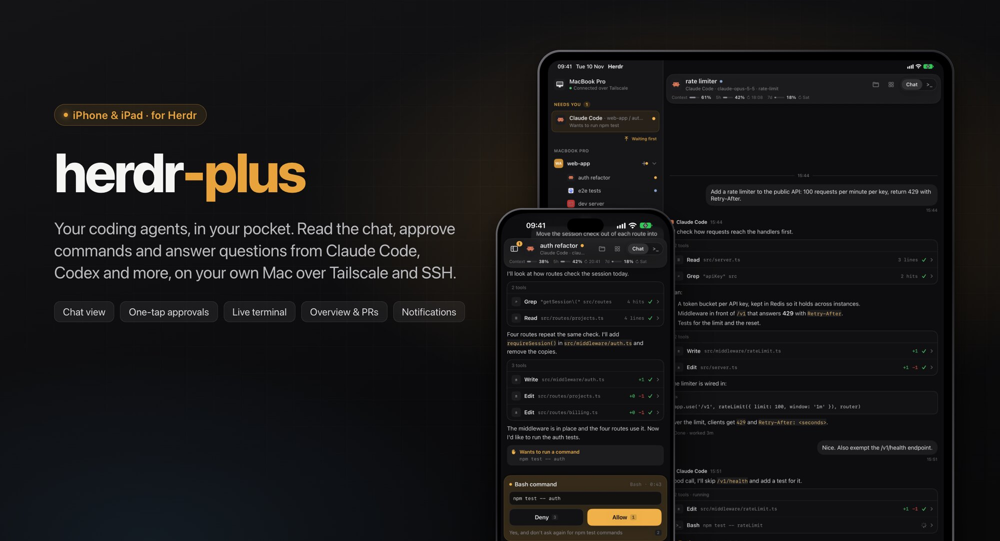
</p>

# herdr-plus

An iPhone and iPad client for [herdr-core](https://github.com/herdrdev/herdr-core). It shows the spaces, tabs and agents running on your Mac, and lets you answer them from your phone.

> **Unofficial.** herdr-plus is not affiliated with, endorsed by, or supported by Herdr, Inc. It uses only herdr-core's public JSON-RPC API.

## Screenshots

<p align="center">
  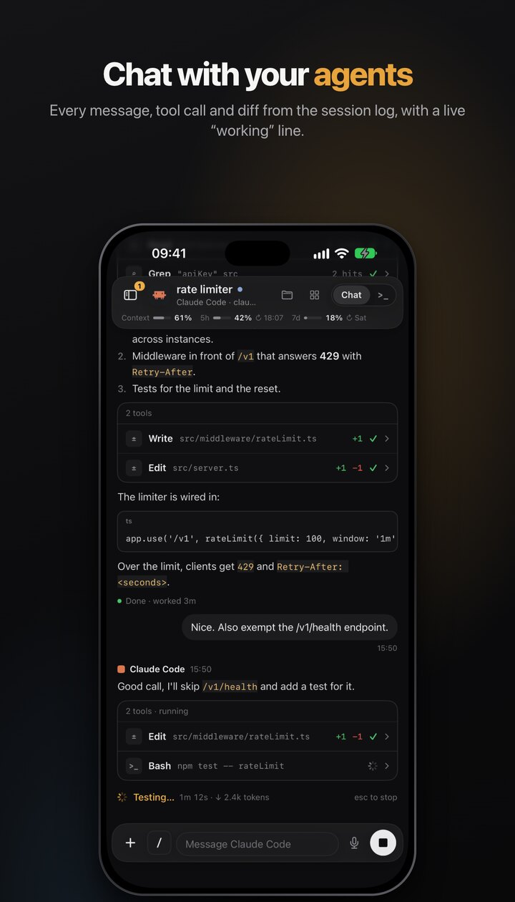
  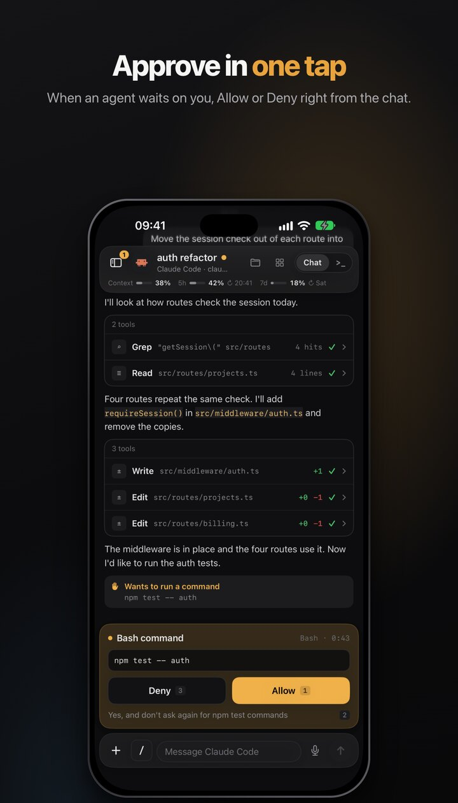
  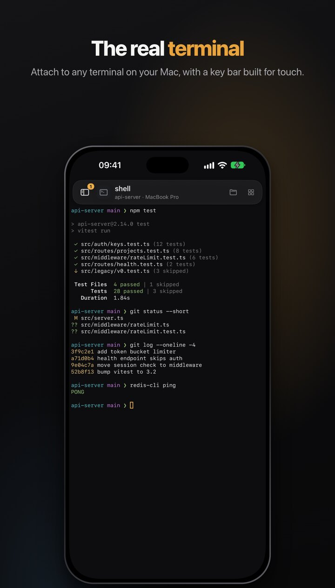
</p>
<p align="center">
  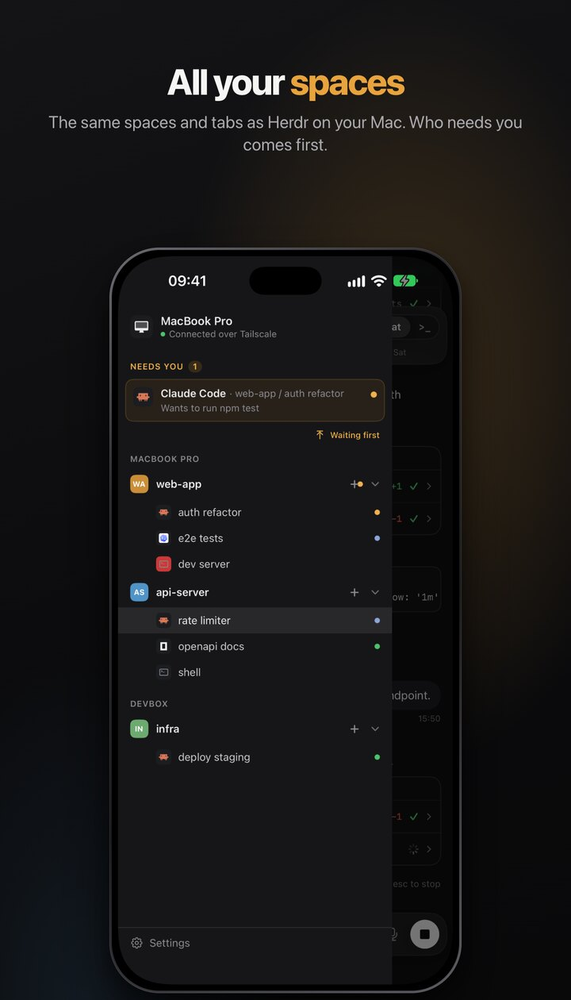
  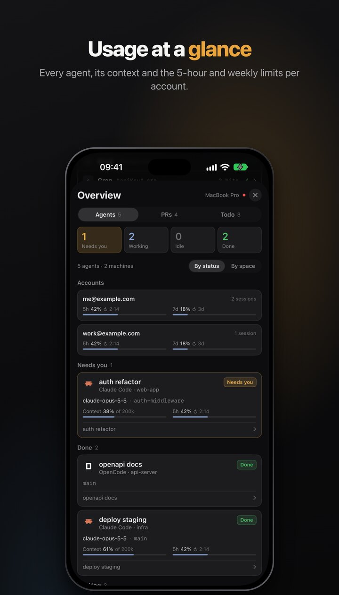
  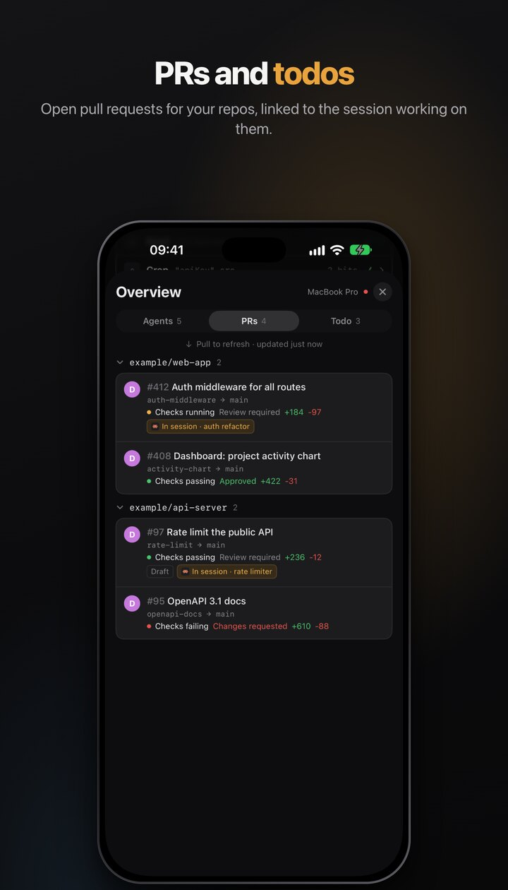
</p>
<p align="center">
  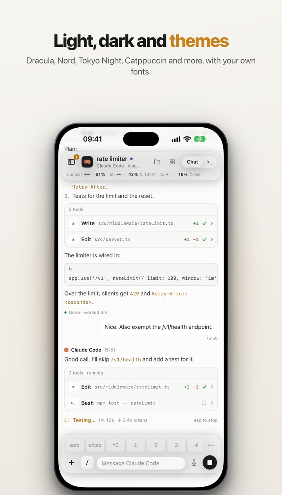
  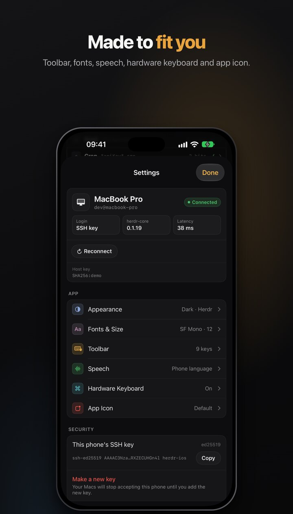
  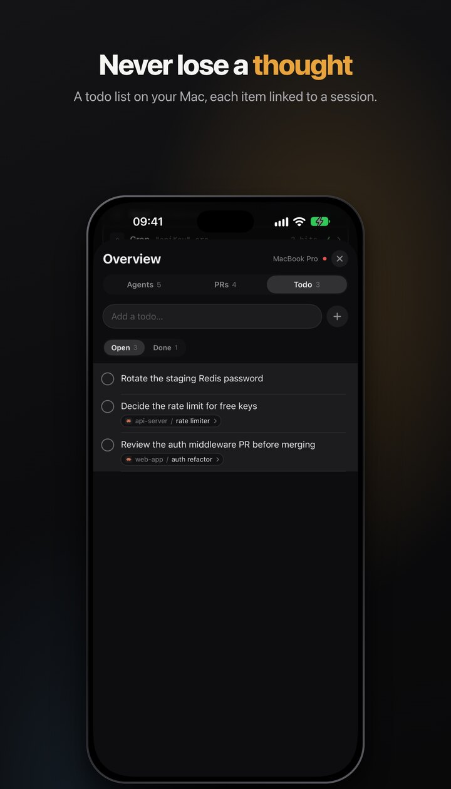
</p>

### Setup

<p align="center">
  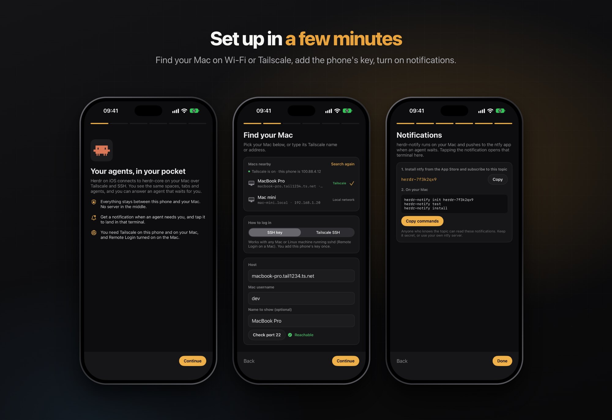
</p>

### iPad

<p align="center">
  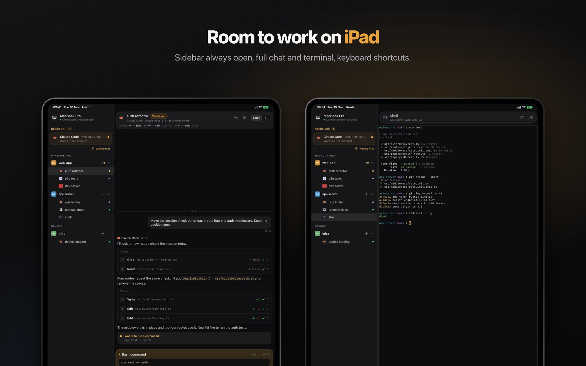
</p>

<sub>Screenshots from the app running in the iOS Simulator with made-up demo data.</sub>

## How it works

The app connects to your Mac over SSH (usually through Tailscale) and runs `hc connect`. That gives it the same JSON-RPC stream the Herdr desktop app uses: spaces, tabs, terminals, agent status and events. Terminals stream over the same connection. Nothing runs in the cloud; the phone talks only to your own machines.

## Features

**Connect**
- Finds Macs on your network and tailnet (Bonjour and Tailscale MagicDNS). Tap a device, enter your user name.
- Sign in with the app's own SSH key (ed25519, kept in the Keychain) or with Tailscale SSH (no key).
- Host key check on first connect, then pinned.
- Reconnects on its own after network changes and when you come back to the app.
- Machines connected to your core show up in the same list.

**Spaces and agents**
- Same spaces, tabs and agents as the Herdr desktop app, read from its layout.
- Agents waiting for you go to the top ("Waiting first").
- New terminal tab or agent tab (Claude Code, Codex, OpenCode, Gemini and more).
- Rename and close tabs; renaming can also rename the Claude session (`/rename`).
- Swipe from the left edge to open the sidebar, swipe back to close it.

**Chat view** (Claude Code and Codex)
- Reads the agent's session log and shows it as a chat: messages, tool calls, diffs, images.
- Shows what the agent is doing right now ("Deliberating… 4m 50s · ↓ 3.4k tokens"), with esc to stop.
- Permission prompts and questions become cards with buttons.
- Slash command suggestions while you type `/`.
- Commands that open a panel (`/usage`, `/model`, `/config`) show live with arrow, tab, enter and esc keys.
- Queue a message while the agent works: cancel, edit or send now.
- Paste images from the clipboard, attach photos, dictate.
- Loads messages from before a compact.
- Context and rate-limit usage per account, with reset time.

**Terminal**
- Full terminal (SwiftTerm) with smooth scrolling.
- Configurable key bar: esc, tab, shift-tab, sticky ctrl, ^C, ^D, ^R, arrows, paste and more.
- Arrow joystick: hold and drag, or tap to keep the pad open.
- Hardware keyboard support with shortcuts (⌘1–9, ⌘J, ⌘K) and Option as Meta.

**Workspace**
- Files browser with git status.
- Diff view in the style of a GitHub PR review.
- Open pull requests for the repos in your sessions (uses `gh` on the machine).
- Overview: agents by status or by space, worktree and context per agent, a shared to-do list linked to sessions.

**Look and feel**
- Themes: System, Light, Dark, Dracula, Nord, Tokyo Night, Catppuccin, Gruvbox, One, Solarized, GitHub.
- Fonts and sizes for terminal and chat (JetBrains Mono, Hack Nerd Font, MesloLGS NF, SF Mono).
- Floating or docked top and bottom bars, Liquid Glass keys, text or symbol labels.
- Alternative app icons.

**Notifications**
- Push through [ntfy](https://ntfy.sh) when an agent waits for you: `herdr-notify` runs on the Mac and watches your terminals.
- Badge count of agents that need you.

## Install

The app is not on the App Store. Install the unsigned IPA with [Feather](https://github.com/khcrysalis/Feather) (or another sideloading tool) and sign it with your own certificate.

Add this source in Feather:

```
https://raw.githubusercontent.com/OMKE/herdr-plus/main/feather/source.json
```

New versions show up there as they are released. The IPA files are attached to [GitHub Releases](https://github.com/OMKE/herdr-plus/releases).

### On your Mac

1. Install and run [herdr-core](https://github.com/herdrdev/herdr-core).
2. Turn on Remote Login (System Settings → General → Sharing), or use Tailscale SSH.
3. Install Tailscale on the Mac and on the phone, signed in to the same tailnet.
4. Open the app and follow the steps. It shows the public key to add to `~/.ssh/authorized_keys` if you use the SSH key option.

## Build

Requirements: Xcode 16 or later, [XcodeGen](https://github.com/yonaskolb/XcodeGen).

```sh
cd App
xcodegen generate
open HerdrIOS.xcodeproj
```

Unsigned IPA:

```sh
scripts/build-ipa.sh
```

Tests:

```sh
cd Packages/HerdrKit && swift test
```

## Layout

| Path | What |
|------|------|
| `App/` | SwiftUI app (iOS 17+) |
| `Packages/HerdrKit/` | herdr-core client, SSH transport, chat log parser, git helpers |
| `docs/design/` | Design prototype and the prompt used for it |
| `scripts/` | IPA build, icon generation |
| `feather/source.json` | Feather source, updated on each release |

## Credits

The chat log parser and screen detection are ported from [Flockbook](https://github.com/minchenlee/flockbook) (MIT). See [THIRD_PARTY_NOTICES.md](THIRD_PARTY_NOTICES.md) for fonts and packages.

## License

[MIT](LICENSE)
